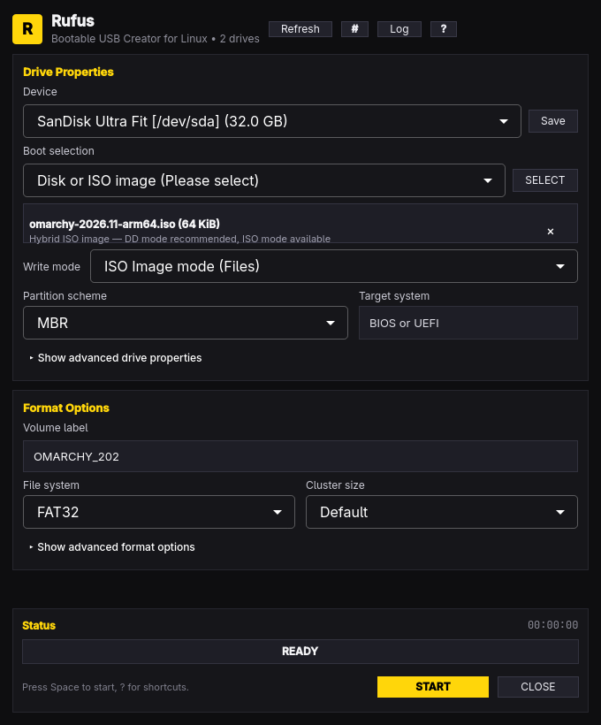

# Rufus for Linux (`rufus-linux`)



A native Linux (`aarch64` / `x86_64`) recreation of [Pete Batard's Rufus](https://github.com/pbatard/rufus), built as a single C++ / Qt Quick desktop app for Omarchy.

## Features

- **Removable USB Detection & Safety:** Automatically monitors removable USB drives via `lsblk`, strictly protecting internal disks and any disk hosting `/`, `/boot`, `/boot/efi`, or `/home`. Optional *List USB Hard Drives* toggle.
- **Bootable Media Creation:**
  - **DD Image Mode:** Direct raw or streamed compressed (`.gz`, `.xz`, `.bz2`, `.zst`, `.zip`) writing with live MB/s speed and progress.
  - **ISO Image Mode:** Partitions (GPT / MBR), formats (`FAT32`, `NTFS`, `exFAT`, `ext4`, `ext3`, `ext2`, `UDF`), and extracts ISO contents directly via `libarchive`.
  - **Windows ISOs & UEFI:NTFS:** Automatically detects Windows ISOs, >4 GiB `install.wim` files, and embeds Rufus's `uefi-ntfs.img` 1 MiB bootloader partition so UEFI firmware boots NTFS drives directly.
  - **Windows User Experience (`autounattend.xml`):** Ported from Rufus's `src/wue.c` — bypass 4GB RAM / Secure Boot / TPM 2.0, bypass Microsoft account (`BypassNRO`), create a local account, skip privacy prompts, disable BitLocker auto-encryption, and optional QoL tweaks.
  - **Linux Persistence:** Optional `ext4` persistence partition (`casper-rw` / `persistence` + `persistence.conf`) for supported live Linux ISOs.
  - **FreeDOS & Non-Bootable Formatting:** Bundled FreeDOS system files from Rufus, custom volume labels, cluster sizes, quick/full format, and 1–4 pass bad blocks checking.
- **Image Checksums & Verification:** Streaming single-pass MD5, SHA-1, SHA-256, and SHA-512 computation with one-click copy and expected hash verification.
- **Drive Backup:** Save any USB drive to a raw `.img` file.
- **Live Omarchy Integration:** Follows the active Omarchy accent color, Hyprland window rounding, and system language live; uses `xdg-desktop-portal` for file dialogs and PolicyKit (`pkexec`) / `sudo` for privileged disk writes.

## Keyboard Shortcuts

| Key | Action |
|-----|--------|
| `O` | Select ISO or disk image |
| `R` | Refresh USB devices |
| `Space` | Start / Cancel operation |
| `H` | Compute and verify image checksums |
| `W` | Open Windows User Experience options |
| `S` | Save selected USB drive to `.img` |
| `L` | Toggle operation log |
| `?` | Show or hide keyboard shortcuts |
| `Esc` | Close active dialog |
| `Q` | Quit Rufus |

## CLI Usage

```sh
rufus-linux [image-file]              # Launch desktop GUI (optionally pre-loading an image)
rufus-linux list [--all-usb] [--json] # List safe removable USB drives
rufus-linux inspect <file> [--json]   # Analyze an ISO or disk image
rufus-linux hash <file> [--json]      # Compute MD5, SHA-1, SHA-256, and SHA-512
```

## Build, Test & Install

```sh
./bin/build    # Build build/rufus-linux with qmake6 + make
./bin/test     # Run the offscreen Qt Test suite
./bin/install  # Package and install via makepkg -fsi (adds Rufus to the launcher)
```
